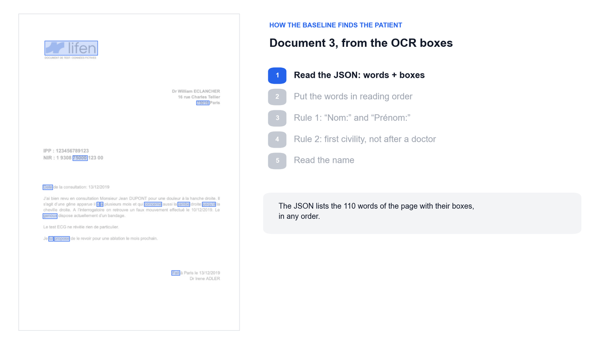

# Find the patient's name in a medical document: an empirical rule-based baseline

Medical documents, in order for them to be legally valid must contain civilities (Mme, M., Monsieur, Madame) before a name and the name has to be written in full-caps. 
The simple, rule-based heuristic here aims at exploiting this legal obligation. 



## The task

**Input**: a JSON document. Each page lists its words with a bounding box. Coordinates go from 0 to 1
from the top-left corner, and the words come in no particular order.

```json
{"pages": [{"words": [
  {"text": "Monsieur", "bbox": {"x_min": 0.37, "x_max": 0.45, "y_min": 0.57, "y_max": 0.59}},
  ...
]}]}
```

**Output**: `(first_name, last_name)`, `(None, last_name)` when only the last name is written, or
`None` when no clue is found.

## Quick start

Open `heuristic.ipynb` and run the cells, or reuse the two
functions:

```python
import json

with open("examples/example3.json", encoding="utf-8") as file:
    document = json.load(file)

find_patient(document)  # ('Jean', 'DUPONT')
```
## How to improve the rule-based heuristic

### Read a page like a person would

1. **Rebuild the layout.** Cut each line into *pieces* of a sentence, then stack the pieces into *blocks*: same column. Blocks are
   paragraphs, address blocks, sidebars, stickers.
2. **Skip contact blocks.** Ignore any block with a line starting with `Dr`, `Pr`, `Tél` or `Fax`:
   letterhead, staff list, recipient address, signature.

### Score based approach

The idea is to exploit the fact that spatial information about the words is encoded in the JSON. 
Kind of like a KNN algorithm: look for what's around a name, is there a civility nearby ? Or a "Professeur", nearby instead ?

3. **Score clues and choose.** Each clue gives points to a last name (form label 3, civility 2,
   `né(e) le` 2). Points add up over the whole document and the best total wins: a patient named
   three times beats a relative named once (DURAND 6, PETIT 2).
   the two words before `né(e) le` on stickers. Fixes issues 2 and 3.

### How to measure robustness of a classifier

**Tests and a benchmark.** Precision, recall and F1 scores of these classifiers could be computed if access to more documents was readily available. 


## Repository structure

```
heuristic.ipynb        the heuristic: read_words() and find_patient()
example.json           a short sample document
examples/              three example documents in the challenge's JSON format
  issues/              four fictional documents where the heuristic fails (JSON + PDF)
visuals/               figures and an animation of each step
  issues/              the four failure cases
  layout_version/      the layout-based improvements (blocks, skipped blocks, votes)
jev/                   state and questions to test example1 with TypeSafe's Jev
presentation/          slides, LaTeX sources and PDFs: part 1 heuristic, part 2 machine learning
```

## Presentations

- [Part 1: the heuristic](<presentation/présentation LIFEN Heuristic.pdf>)
- [Part 2: NER and a fine-tuned LLM](<presentation/présentation LIFEN ML.pdf>)
